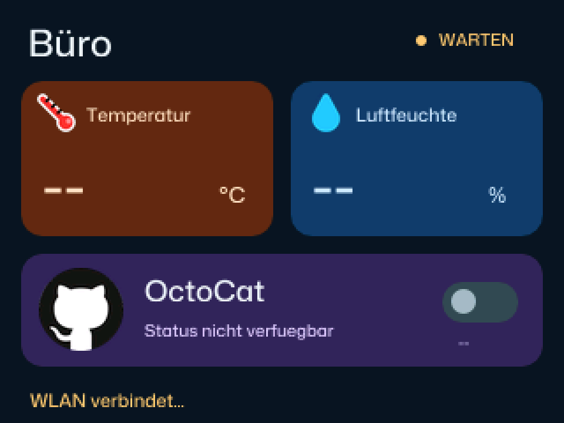

# HA-Office

Ein farbiges Home-Assistant-Dashboard fuer den **GitHub Universe 2026 Badge**:
Temperatur, Luftfeuchtigkeit und eine schaltbare WLED-OctoCat-Lampe.



## Funktionen

- Temperatur mit Thermometer-Emoji auf orangem Hintergrund.
- Luftfeuchtigkeit mit Tropfen-Emoji auf blauem Hintergrund.
- OctoCat-Lamp mit Octocat-Bild und bestaetigtem Ein-/Aus-Status.
- Aktualisierung beim Start, manuell und automatisch alle **5 Minuten**.
- Lampenstatus alle **5 Sekunden**, auch nach externen Schaltvorgaengen.
- Sichtbare Verbindungsfehler und Markierung veralteter Messwerte.
- HTTPS mit Zertifikats- und Hostnamenpruefung.

## Bedienung

| Taste | Aktion |
|---|---|
| SELECT | Zurueck zum Home-Launcher |
| RUNTER | OctoCat-Lamp ein-/ausschalten |
| LINKS, RECHTS, HOCH | Alle Werte aktualisieren |
| MENU, BACK | Ebenfalls aktualisieren |
| HOME | Firmware-eigene Rueckkehr zum Launcher |

Der Ordner heisst aus Kompatibilitaetsgruenden `office`; der App-Titel lautet
**HA-Office**. Der Firmware-Launcher kann die Kachel weiterhin als Office anzeigen.

## Voraussetzungen

GitHub Universe **2026** Badge mit passender MicroPython-Firmware, WLAN und
einer erreichbaren Home-Assistant-Instanz mit HTTPS. Die alten Universe-2025-APIs
sind nicht kompatibel. Die App verwendet die auf dem Badge vorhandenen Module
`fetch`, `wifi`, `tls`, `missing_details` und Mona Sans.

Die drei verwendeten Entities stehen in
[`office_client.py`](badge/apps/office/office_client.py):

| Anzeige | Entity-ID im urspruenglichen Setup |
|---|---|
| Temperatur | `sensor.gewachshaus_temperatur` |
| Luftfeuchtigkeit | `sensor.gewachshaus_luftfeuchtigkeit` |
| OctoCat-Lamp | `light.wled` |

Vor der Installation an die eigene Home-Assistant-Konfiguration anpassen.

## Einrichtung auf Windows

Den Badge in USB Disk Mode versetzen. Die folgenden Beispiele setzen voraus,
dass das als **BADGER** bezeichnete Laufwerk `E:` ist und die serielle
Schnittstelle `COM5` lautet. Vor Ausfuehrung die tatsaechlichen Werte pruefen.

1. WLAN in `E:\secrets.py` eintragen: `WIFI_SSID` und `WIFI_PASSWORD`.
   Die App liest diese Datei explizit als `/system/secrets.py` und nicht eine
   eventuell vorhandene alte `/secrets.py` im internen Dateisystem.
2. Separat `E:\office_ha.json` anlegen:

   ```json
   {
     "url": "https://home-assistant.example:8123",
     "token": "YOUR_HOME_ASSISTANT_ACCESS_TOKEN"
   }
   ```

3. `badge\apps\office` nach `E:\apps\office` kopieren. Vorhandene Installationen
   vorher sichern. Manche Firmware verwendet `E:\system\apps` statt `E:\apps`.
4. BADGER sicher auswerfen. Die App verbindet WLAN und synchronisiert nach
   Stromverlust automatisch die Uhr per NTP, bevor sie HTTPS verwendet.
   Falls UDP-Port 123 im Netzwerk blockiert ist, muss er fuer `pool.ntp.org`
   bzw. `time.cloudflare.com` erreichbar gemacht oder die Uhr per USB gesetzt werden:

   ```powershell
   python -m mpremote connect COM5 rtc --set
   python -m mpremote connect COM5 reset
   ```

5. **Office** im Launcher oeffnen. Das eigene Menue-Icon benoetigt eine Firmware
   mit `icon.png`-Unterstuetzung; die App selbst funktioniert auch ohne diese.

### Automatisch beim Einschalten starten

HA-Office kann nach der normalen Startanimation statt des Launchers starten.
SELECT und HOME fuehren weiterhin zum Launcher: dessen Watchdog-Neustart wird
nicht zum erneuten Autostart verwendet. USB Disk Mode bleibt unveraendert.
Nach Installation der App und Pruefung des BADGER-Laufwerks:

```powershell
python tools\configure_autostart.py --mount 'E:\'
python tools\configure_autostart.py --mount 'E:\' --write
```

Das Werkzeug prueft die Bootdatei und sichert das Original unter
`.badge-app-backups\main.py-<Zeitstempel>`, bevor es `main.py` aendert.
Zum Rueckgaengigmachen im Disk-Modus diese Sicherung als `main.py`
zurueckkopieren. Danach BADGER sicher auswerfen.

### CA und optionale Entwicklungswerkzeuge

`ha-ca.der` enthaelt nur ein oeffentliches CA-Zertifikat, keine Zugangsdaten.
Fuer einen anderen Zertifikatsaussteller muss es passend zur eigenen Instanz
neu erzeugt werden. Der Generator verwendet die vom PC verifizierte TLS-Kette.
Er benoetigt CPython 3.11 mit `get_verified_chain()`, Pillow und unter Windows
die vorhandene Segoe-UI-Emoji-Schrift:

```powershell
python -m pip install Pillow mpremote
python tools\prepare_badge.py --url 'https://home-assistant.example:8123'
```

Die URL im Beispiel ist ein Platzhalter und muss ersetzt werden.
Wer die mitgelieferten Bilder und die passende CA unveraendert verwendet,
braucht zur Laufzeit weder Pillow noch Desktop-Schriften.

Optional kann der Generator ein vorhandenes `ha_token` aus einer explizit
angegebenen lokalen `.env` lesen und die separate Badge-Konfiguration
bereitstellen. Siehe die Optionen des Werkzeugs; vorhandene Konfigurationen
werden nicht ueberschrieben.

## Sicherheit und Verhalten

Zugriffstoken und WLAN-Passwort gehoeren **nicht** in den App-Code oder dieses
Repository. `.gitignore` schliesst lokale Konfigurationsdateien aus.
Das Token liegt auf dem physischen Badge lesbar vor: einen dedizierten,
nicht-administrativen HA-Benutzer verwenden, bei Verlust das Token widerrufen
und den Badge nicht mit aktiven Zugangsdaten weitergeben.

Ein Lampenbefehl wird durch erneutes Abfragen des Zustands bestaetigt.
Fehlgeschlagene Schaltbefehle werden nicht automatisch wiederholt.
Nach 5 Minuten und 45 Sekunden ohne erfolgreiche Aktualisierung werden Messwerte
als veraltet markiert. Der Lampenstatus wird separat alle 5 Sekunden abgefragt;
nach 20 Sekunden ohne erfolgreiche Abfrage zeigt er einen unbekannten Zustand
statt AUS, und die Lampensteuerung wird deaktiviert.

Die App verwaltet WLAN direkt, ohne den moeglicherweise veralteten Zustand des
Firmware-`wifi`-Moduls zu uebernehmen. Nach Ausfaellen startet sie das Funkmodul
neu und verbindet mit begrenzten Versuchen und 1 bis 30 Sekunden Wiederholpause.
Eine auf 2021 zurueckgesetzte Uhr wird vor HTTPS automatisch per NTP korrigiert;
Zertifikatspruefung bleibt immer aktiv. Netzwerk- und Zeitfehler werden angezeigt.
Nach Wiederverbindung werden alle Werte sofort neu abgefragt. Schaltbefehle
aus einer abgebrochenen Verbindung werden niemals automatisch wiederholt.

## Entwicklung

Die Skills werden ueber `skills-lock.json` referenziert; ihre lokalen Kopien
sind nicht Bestandteil dieses Repositorys. Installieren:

```powershell
npx --yes skills add https://github.com/badger/home --skill hyb26-skill --agent github-copilot --copy --yes
npx --yes skills add https://github.com/markpitt/claude-skills --skill home-assistant-api --agent github-copilot --copy --yes
```

Tests und statische Badge-Validierung:

```powershell
python -m unittest discover -s tests -v
python .agents\skills\hyb26-skill\scripts\validate_app.py badge\apps\office --target hardware
```

`tools\check_on_badge.py` prueft WLAN und die drei Entity-Abfragen direkt auf
dem Badge, ohne die Lampe zu schalten. `tools\render_on_badge.py` erzeugt einen
Framebuffer-Screenshot. Beide sind fuer Ausfuehrung mit `mpremote run` gedacht,
nicht fuer Desktop-Python. Der Browser-Simulator kann Netzwerk und echtes
Schalten nicht nachweisen.

`tools\check_connection_recovery.py` prueft auf dem Badge gezielt den
Stromverlust-Fall (RTC auf 2021), automatische Zeitsynchronisation, geprueftes
HTTPS und Wiederverbindung nach Abschalten des Funkmoduls. Die Lampe wird
dabei nicht geschaltet; die Uhr wird durch die normale NTP-Logik korrigiert.

## Bildnachweise

Das Octocat-Motiv wurde fuer dieses Projekt vom Benutzer als Bild-URL
bereitgestellt; die Quelle ist in der [App-README](badge/apps/office/README.md)
dokumentiert. Octocat und GitHub sind Kennzeichen von GitHub; dieses Projekt
ist keine offizielle GitHub- oder Home-Assistant-Anwendung.
Die Emoji-PNGs wurden aus der lokal installierten Segoe UI Emoji erzeugt;
die Schriftdatei wird nicht mitgeliefert. Rechte an fremden Bildern, Marken
und Schriftgrafiken verbleiben bei den jeweiligen Rechteinhabern.
